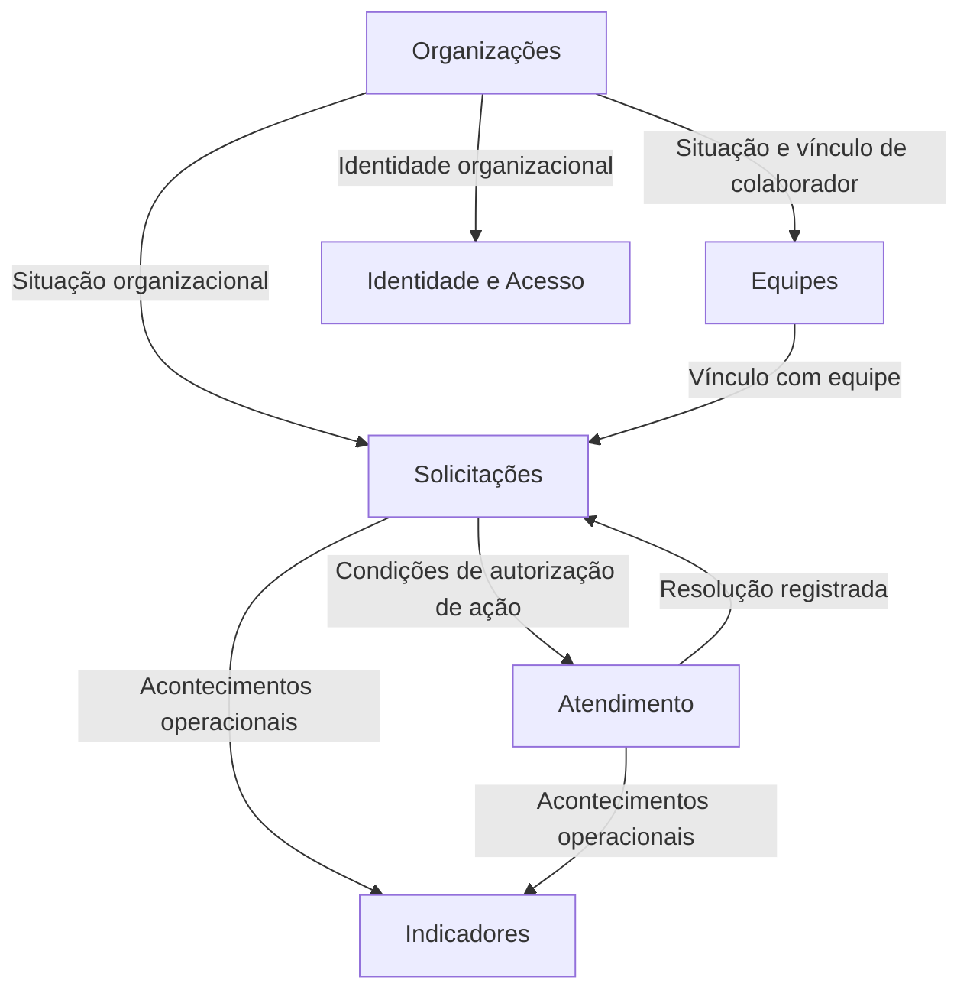

# NEXORA — Parte 05: Modelagem Estratégica do Domínio

> Documento de modelagem | Versão 1.0 (rascunho controlado) | 11 de outubro de 2026  
> Referência: **NEXORA — Parte 04: Escopo do MVP e Linguagem Ubíqua**

## 1. Objetivo e limites

Documentar a descoberta estratégica posterior à Parte 04: proposta de valor, capacidades, subdomínios candidatos, classificação estratégica, Bounded Contexts candidatos, relações e decisões. **A Parte 04 prevalece em caso de divergência.** Este documento não define microsserviços, infraestrutura, banco de dados ou contratos técnicos.

**Legenda:**
- **Confirmado no MVP:** previsto na Parte 04.
- **Decisão de trabalho:** acordo obtido na discussão de modelagem, sujeito a validação com o negócio.
- **Hipótese:** proposta de modelagem ainda não ratificada.
- **Em aberto:** falta decisão explícita.

## 2. Proposta de valor

**Decisão de trabalho:** a Nexora busca reduzir ruídos na comunicação interna, dar clareza sobre a responsabilidade pelas demandas e transformar os acontecimentos dos atendimentos em visibilidade operacional. A vantagem pretendida não é apenas abrir chamados: é coordenar necessidades entre pessoas e equipes com rastreabilidade.

Os três eixos são:
1. Responsabilidade clara pela demanda.
2. Histórico confiável de ações, decisões e alterações.
3. Indicadores básicos para revelar pendências, volume e resolução.

## 3. Capacidades e subdomínios candidatos

| Subdomínio candidato | Problema de negócio | Classificação inicial | Maturidade |
| --- | --- | --- | --- |
| Gestão de Solicitações | Registrar necessidades e coordenar triagem, atribuição e ciclo de vida | **Core candidato** | Hipótese estratégica forte |
| Gestão de Atendimento | Registrar execução, interações e tentativas de resolução | Supporting candidato | Hipótese |
| Gestão de Equipes | Organizar equipes, membros e gestores | Supporting candidato | Hipótese |
| Gestão Organizacional | Manter organizações e vínculos dos colaboradores | Supporting candidato | Hipótese |
| Identidade e Acesso | Autenticação, papéis e permissões | Generic candidato | Hipótese |
| Indicadores Operacionais | Consolidar volume, pendências e resoluções | Supporting candidato, com potencial estratégico | Hipótese |

**Nota:** importância operacional não equivale automaticamente a Core Domain. A classificação acima deriva da proposta de diferenciação relatada e deverá ser reavaliada com evidências do negócio. Uma capacidade não corresponde necessariamente a um único Bounded Context.

## 4. Bounded Contexts candidatos

| Contexto | Autoridade proposta | Não deve controlar diretamente |
| --- | --- | --- |
| Organizações | Organização, colaboradores, vínculo e situação organizacional | Composição das equipes, interações |
| Equipes | Equipes, membros e gestores | Estado das solicitações |
| Identidade e Acesso | Credenciais, autenticação e permissões de acesso | Vínculo de equipe e resolução de demandas |
| Solicitações | Abertura, triagem, prioridade, atribuição, estado, confirmação e encerramento | Conteúdo interno das interações e resoluções |
| Atendimento | Trabalho realizado, interações, autoria e resoluções | Atribuição atual e estado autoritativo da solicitação |
| Indicadores | Projeções e consultas de métricas operacionais | Alteração de fatos operacionais de origem |

**Status:** fronteiras candidatas. Em particular, Solicitações e Atendimento têm forte necessidade de consistência e sua separação em dois Bounded Contexts deve continuar sendo testada. Nenhum contexto implica um microsserviço.

## 5. Context Map conceitual

**Interpretação:** as setas mostram necessidades de colaboração/informação, **não** dependências de código nem classificação definitiva upstream/downstream. Padrões como Customer/Supplier, Conformist, ACL e Shared Kernel ainda não foram escolhidos.

## 6. Decisões e regras de negócio levantadas

### DEC-01 — Solicitação e atendimento têm propósitos diferentes
**Decisão de trabalho.** Solicitação representa a necessidade e coordena seu ciclo de vida. Atendimento representa o esforço realizado para satisfazê-la. A separação de modelos é desejável, mas o número final de Bounded Contexts permanece hipótese.

### DEC-02 — Resolução não equivale a encerramento
**Confirmado no MVP.** O atendente registra a resolução; o solicitante pode confirmá-la ou contestá-la. O encerramento depende da confirmação válida. Contestação retoma o trabalho sem gerar uma nova solicitação.

### DEC-03 — Um responsável atual; autoria histórica preservada
**Decisão de trabalho.** Uma solicitação tem no máximo um atendente responsável atual. Reatribuições não mudam a autoria de interações anteriores. Múltiplos responsáveis simultâneos ficam fora da proposta inicial e exigem validação explícita para evolução.

### DEC-04 — Mesmo atendimento ao longo da necessidade
**Decisão de trabalho.** Trocas de equipe ou de atendente e contestações de resolução não criam automaticamente outro atendimento. Tentativas de resolução e contribuições anteriores permanecem rastreáveis.

### DEC-05 — Remoção de membro da equipe
**Decisão de trabalho.** Ao perder vínculo com a equipe responsável, um atendente não pode continuar praticando novas ações atribuídas por ela. Solicitações afetadas ficam pendentes de reatribuição; o gestor é informado e designa pessoa elegível. O histórico permanece. **Pendente:** detalhar momento da efetivação, transições e política de notificações.

### DEC-06 — Situação organizacional não é vínculo de equipe
**Decisão de trabalho.** Um colaborador pode continuar ativo na organização e com acesso ao sistema sem integrar determinada equipe. Organizações controla vínculo/situação organizacional; Equipes controla associação de membros; Identidade e Acesso controla acesso. Elegibilidade para atribuição pode depender de mais de uma dessas informações.

### DEC-07 — Mínimo conhecimento entre contextos
**Decisão de modelagem.** Solicitações obtém de Equipes apenas o necessário para avaliar vínculo/elegibilidade; Atendimento obtém de Solicitações uma avaliação de autorização para a operação, sem conhecer todo o modelo nem necessariamente a identidade do responsável atual. Nenhum contexto altera diretamente as entidades internas do outro.

### DEC-08 — Comunicação de resolução
**Decisão de modelagem.** Atendimento comunica que uma resolução foi registrada; Solicitações decide como esse acontecimento altera seu ciclo de vida e permite confirmação/contestação. Não há regra confirmada exigindo notificação ao gestor a cada resolução. Notificação ao solicitante é uma necessidade de experiência a detalhar, sem presumir mecanismo específico.

### DEC-09 — Concorrência entre transferência e resolução
**Decisão de trabalho.** Transferência efetivada impede novas ações do antigo responsável. Resoluções validamente registradas antes da transferência permanecem no histórico. A consistência entre validação e gravação deverá ser garantida na implementação; mecanismo ainda não definido.

## 7. Fronteiras importantes da linguagem

| Termo | Em Solicitações | Em Atendimento |
| --- | --- | --- |
| Responsável | Atendente atualmente designado | Autor de cada ação e participantes históricos (não necessariamente o responsável atual) |
| Estado | Situação da necessidade no ciclo de vida | Progresso do trabalho; estados próprios ainda não confirmados |
| Resolução | Acontecimento que permite aguardar confirmação | Declaração registrada por atendente autorizado |
| Encerramento | Decisão sobre o ciclo da solicitação | Consequência para o trabalho; necessidade de estado próprio a validar |

## 8. Rastreabilidade e indicadores

**Confirmado no MVP:** deve ser possível reconstruir os acontecimentos principais da solicitação, incluindo mudanças de estado e responsável, e consultar indicadores básicos de volume, pendências e resolução.

**Decisão de modelagem:** cada contexto é responsável pela veracidade dos fatos que produz; Indicadores consome dados necessários à leitura operacional. Não há decisão de usar event sourcing, mensageria, um banco por contexto ou um Bounded Context exclusivo de Histórico.

## 9. Questões em aberto

1. Quais regras completas determinam a elegibilidade para receber ou manter uma atribuição?
2. O que ocorre ao desativar um colaborador na organização: acesso, atribuições existentes e atendimento em curso?
3. Como ficam notificações, confirmação de recebimento e tratamento de falhas?
4. Qual garantia de consistência é exigida entre registrar resolução e atualizar o ciclo de vida da solicitação?
5. A separação Solicitações/Atendimento em dois Bounded Contexts se sustenta frente às invariantes transversais?
6. Quais padrões de relacionamento entre contextos são apropriados?
7. Quais indicadores e definições de cálculo são exigidos no MVP?

## 10. Fora de escopo

Mantêm-se as exclusões da Parte 04: construtor de fluxos, revisão/publicação/versionamento de processos configuráveis, automações avançadas, IA, cobrança recorrente, integrações profundas e relatórios avançados. Conversas anteriores sobre esses temas não alteram o MVP.

## 11. Próximo passo

Validar as fronteiras críticas e detalhar o modelo tático de Solicitações, sem transformar hipóteses em requisitos obrigatórios. Ver **Parte 06**.
