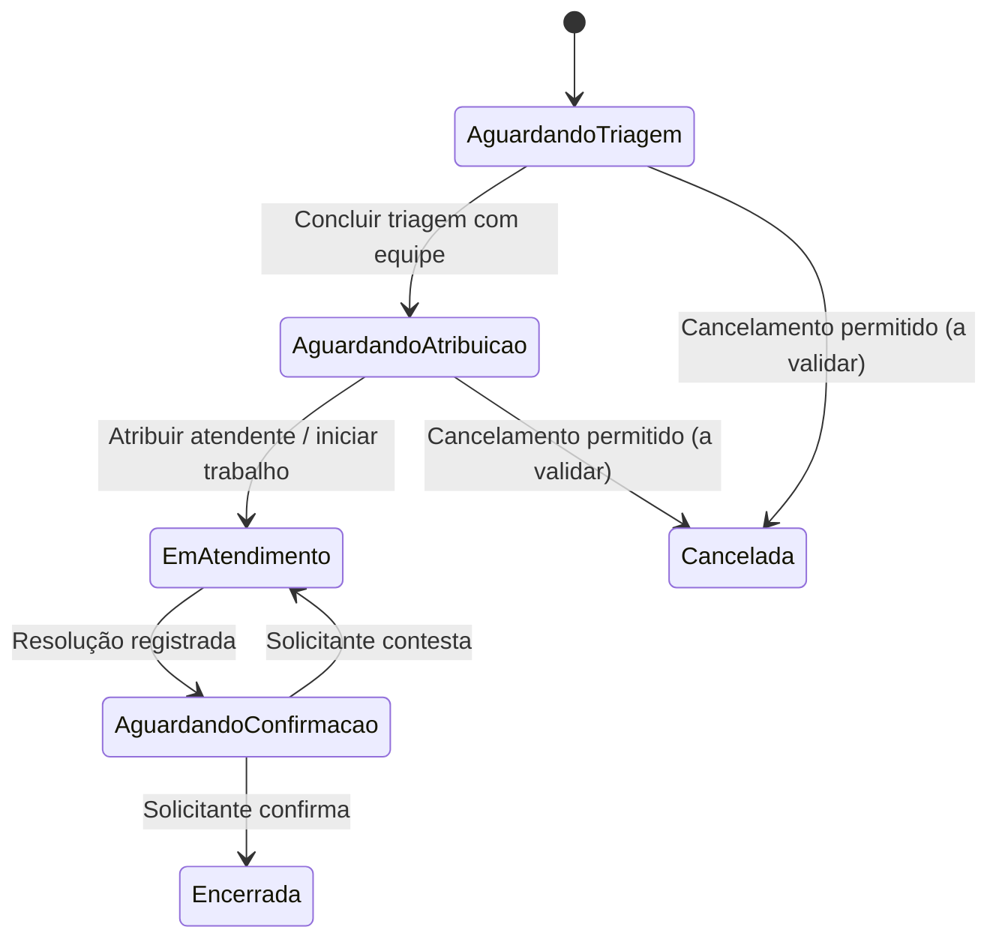
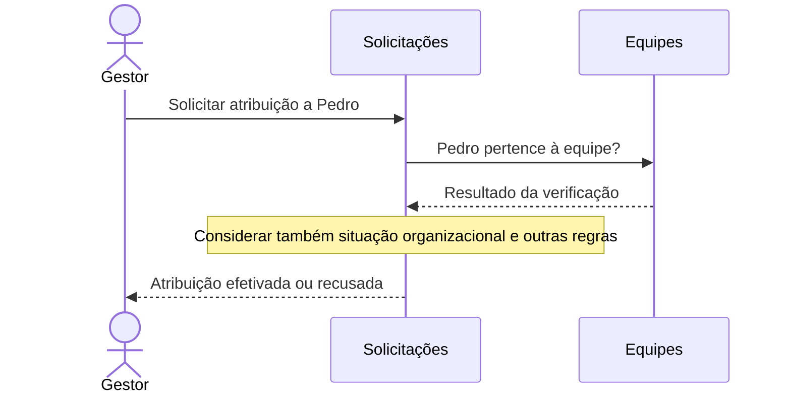
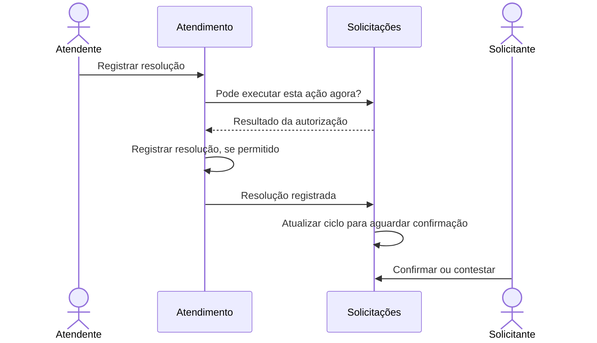

# NEXORA — Parte 06: Modelagem Tática Inicial — Solicitações

> Documento de modelagem | Versão 0.1 (em elaboração) | 11 de outubro de 2026  
> Referências: Parte 04 (escopo e linguagem) e Parte 05 (DDD estratégico)

## 1. Objetivo

Definir um primeiro modelo tático para **Gestão de Solicitações**, distinguindo regras confirmadas, decisões de trabalho e hipóteses. Não constitui implementação final nem contrato de API.

## 2. Agregado candidato

**Aggregate Root candidata:** `Solicitação`.

**Responsabilidade:** proteger a coerência do ciclo de vida da necessidade registrada: abertura, triagem, atribuição, acompanhamento da resolução, confirmação, contestação e encerramento.

**Não incorpora automaticamente:** entidades completas de Organização, Colaborador, Equipe, Atendimento, Interação ou Resolução. Referências por identidade e colaboração entre contextos são hipóteses preferenciais.

## 3. Dados conceituais

| Dado                        | Origem/observação                                  | Situação                                    |
| --------------------------- | -------------------------------------------------- | ------------------------------------------- |
| Identidade da solicitação   | Identificação única no escopo definido futuramente | Hipótese técnica/conceitual                 |
| Organização                 | Isolamento multiempresa exigido                    | Confirmado no MVP                           |
| Solicitante                 | Autor da necessidade                               | Confirmado no MVP                           |
| Título                      | Informação para abertura                           | Obrigatoriedade: decisão de trabalho        |
| Descrição                   | Informação para abertura                           | Obrigatoriedade: decisão de trabalho        |
| Categoria de serviço        | Prevista no cadastro da solicitação                | Obrigatoriedade em aberto                   |
| Evidências                  | Anexos quando necessários                          | Opcional: hipótese                          |
| Prioridade                  | Definida durante triagem                           | Confirmado no MVP                           |
| Equipe responsável          | Encaminhamento na triagem                          | Confirmado no MVP                           |
| Atendente responsável atual | No máximo um por vez                               | Decisão de trabalho                         |
| Estado da solicitação       | Acompanhamento do ciclo                            | Confirmado no MVP; estados exatos em aberto |
| Data de abertura            | Rastreabilidade                                    | Hipótese coerente com MVP                   |

## 4. Regras e invariantes candidatas

| ID     | Regra                                                                               | Situação                                                          |
| ------ | ----------------------------------------------------------------------------------- | ----------------------------------------------------------------- |
| INV-01 | Solicitação pertence a uma organização e tem solicitante identificável              | Confirmado no MVP                                                 |
| INV-02 | Abertura exige título e descrição não vazios                                        | Decisão de trabalho; validar obrigatoriedade                      |
| INV-03 | Solicitação pode existir sem equipe e sem atendente antes da triagem                | Decisão de trabalho coerente com jornada                          |
| INV-04 | Triagem pode ser preenchida progressivamente                                        | Decisão de trabalho obtida na simulação com especialista          |
| INV-05 | Triagem só é concluída após definir equipe responsável                              | Decisão de trabalho obtida na simulação com especialista          |
| INV-06 | No máximo um atendente responsável atual                                            | Decisão de trabalho                                               |
| INV-07 | Atribuição exige atendente elegível segundo regras de negócio e vínculos relevantes | Confirmado quanto à elegibilidade; critérios detalhados em aberto |
| INV-08 | Registrar resolução não encerra automaticamente a solicitação                       | Confirmado no MVP                                                 |
| INV-09 | Encerramento após confirmação válida do solicitante                                 | Confirmado no MVP                                                 |
| INV-10 | Contestação devolve trabalho ao atendimento, preservando histórico                  | Confirmado no MVP                                                 |
| INV-11 | Reatribuição não reescreve autoria histórica                                        | Decisão de trabalho                                               |
| INV-12 | Colaborador que perdeu elegibilidade não pode praticar novas ações como responsável | Decisão de trabalho                                               |

**Atenção:** invariantes que exigem informações de outros contextos precisam de desenho de consistência. Não se deve presumir que todas podem ser verificadas exclusivamente pelo objeto `Solicitação`.

## 5. Estados e transições — hipótese inicial

**Status do diagrama: hipótese.** O documento Parte 04 define a jornada, não uma enumeração oficial de estados. Os estados `AguardandoAtribuicao`, `Cancelada` e a separação entre atribuição e início efetivo do trabalho ainda exigem validação. Transferência entre equipes, remoção do responsável e cancelamento durante atendimento não estão completamente modelados.

## 6. Comportamentos candidatos do agregado

| Comportamento                        | Intenção de negócio                    | Observações                                                          |
| ------------------------------------ | -------------------------------------- | -------------------------------------------------------------------- |
| `abrir(...)`                         | Registrar necessidade válida           | Exige organização/solicitante; obrigatoriedade de campos a confirmar |
| `classificarPrioridade(...)`         | Registrar resultado parcial da triagem | Triagem pode continuar pendente                                      |
| `encaminharParaEquipe(...)`          | Definir equipe responsável             | Exige vínculo organizacional e regras pertinentes                    |
| `concluirTriagem(...)`               | Encerrar avaliação inicial             | Equipe obrigatória; prioridade obrigatória ainda em aberto           |
| `atribuirAtendente(...)`             | Designar responsável atual             | Elegibilidade deve ser verificada                                    |
| `reatribuirAtendente(...)`           | Substituir responsável                 | Preserva histórico                                                   |
| `reconhecerResolucaoRegistrada(...)` | Aguardar avaliação do solicitante      | Origem do acontecimento: Atendimento                                 |
| `confirmarResolucao(...)`            | Validar satisfação da necessidade      | Somente solicitante autorizado; estado adequado                      |
| `contestarResolucao(...)`            | Retomar trabalho                       | Mantém mesma solicitação/atendimento                                 |
| `cancelar(...)`                      | Encerrar necessidade sem resolução     | Regras e estados permitidos em aberto                                |

Nomes de métodos são **exemplos de linguagem de domínio**, não assinaturas finais.

## 7. Exemplo de colaboração entre modelos

**Aviso:** sequências são conceituais. Não definem transporte, transações distribuídas, persistência nem garantia de entrega. O cenário de concorrência entre autorização e reatribuição precisa de solução explícita.

## 8. Autorização versus invariante

- **Identidade e Acesso**: autenticação e permissões gerais do usuário.
- **Solicitações**: regras de negócio sobre estado, atribuição e quem pode confirmar.
- **Equipes/Organizações**: informações autoritativas sobre vínculo e situação do colaborador.
- **Atendimento**: só registra ações válidas de trabalho, respeitando as condições de Solicitações.

Não introduzir dependências diretas de framework, ORM ou autenticação na Aggregate Root. A distribuição exata das verificações entre aplicação, políticas e domínio será decidida ao implementar casos de uso.

## 9. Histórico e consistência

- Toda mudança relevante de estado ou responsável deve ser reconstruível (MVP).
- Interações mantêm seus autores originais após reatribuição.
- Uma resolução validamente registrada antes de uma transferência não é apagada.
- Transferência efetivada bloqueia novas ações do antigo responsável.
- É necessário evitar perda de comunicação entre registro de resolução e atualização da solicitação; mecanismo pendente.

Não foi decidido adotar Event Sourcing, Outbox, fila ou comunicação síncrona.

## 10. Pendências antes de implementar

1. Categoria é obrigatória na abertura?
2. Evidências são sempre opcionais?
3. Prioridade é obrigatória para concluir triagem?
4. Atribuição já significa `EmAtendimento` ou existe início explícito do trabalho?
5. Cancelamento é permitido em quais estados e por quais atores?
6. Transferência de equipe e perda de elegibilidade alteram quais estados?
7. Como garantir atomicidade/consistência entre atribuição, autorização e resolução?
8. Quais são as regras para confirmação tardia ou repetida?
9. Qual política para resolução registrada simultaneamente a uma transferência?
10. Solicitações e Atendimento devem mesmo ser dois Bounded Contexts separados?

## 11. Próxima atividade

Validar a máquina de estados com a especialista do negócio, priorizar invariantes essenciais e só então definir Value Objects, entidades auxiliares, eventos de domínio, repositório e testes do agregado.
