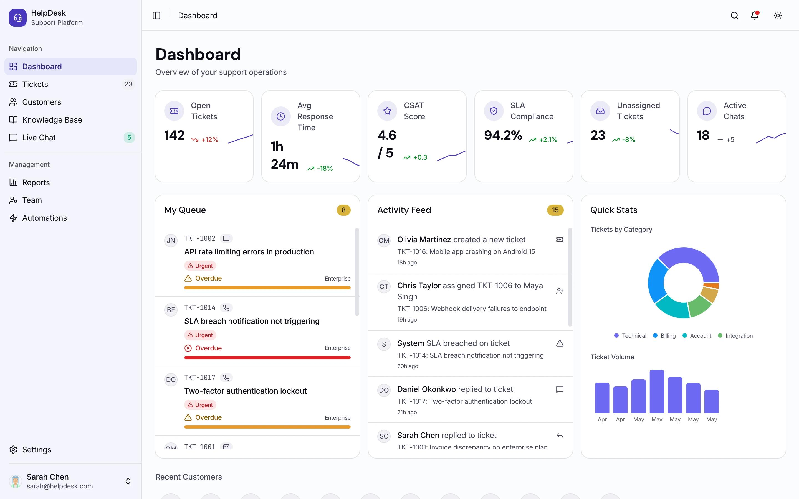

# Nexora

## O que é a Nexora

A **Nexora** é uma plataforma digital de gestão de serviços corporativos. Ela conecta pessoas que precisam de um serviço às equipes responsáveis por realizá-lo, reunindo solicitações, atendimentos e informações em um único ambiente.

Empresas utilizam a Nexora para organizar demandas de diferentes departamentos, como tecnologia da informação, recursos humanos, financeiro e administração. Cada solicitação pode ser acompanhada desde o momento em que é registrada até a conclusão do atendimento. Quem solicita sabe o que está acontecendo; quem atende sabe o que precisa fazer; quem gerencia consegue enxergar o trabalho em andamento.

A Nexora funciona como um serviço por assinatura para empresas. Cada organização possui seu próprio ambiente, com seus colaboradores, equipes, solicitações e informações.

## A história da Nexora

### O cotidiano do Grupo Horizonte

O Grupo Horizonte é uma empresa com aproximadamente 150 colaboradores. Suas atividades dependem do trabalho conjunto de vários departamentos. A equipe de tecnologia mantém sistemas e equipamentos funcionando; o setor financeiro cuida de pagamentos e reembolsos; recursos humanos atende às necessidades dos funcionários; e a administração coordena serviços e recursos internos.

Com o crescimento da empresa, uma dificuldade começou a aparecer em todos esses setores: ninguém tinha uma visão completa das solicitações recebidas e do andamento de cada atendimento.

Quando um computador parava de funcionar, o funcionário enviava uma mensagem para alguém da TI. Quando precisava de um documento, procurava uma pessoa do RH. Um pedido de reembolso podia chegar por e-mail, enquanto a solicitação de um equipamento era feita durante uma conversa no corredor.

Cada equipe tentava se organizar à sua maneira. Algumas mantinham planilhas; outras dependiam das mensagens recebidas. Muitas solicitações eram atendidas, mas o histórico ficava espalhado. Outras demoravam porque ninguém sabia exatamente quem havia assumido a responsabilidade.

Em uma reunião, o diretor de operações perguntou quantas solicitações estavam abertas, quais estavam atrasadas e quanto tempo a empresa levava para resolvê-las. Os gestores não conseguiram apresentar uma resposta confiável. Para reunir as informações, seria necessário consultar várias pessoas, caixas de e-mail e planilhas.

A empresa percebeu que o problema não era apenas a quantidade de trabalho. Faltava uma forma compartilhada de registrar, organizar e acompanhar o trabalho entre as pessoas.

### O encontro com a Nexora

Foi nesse contexto que o Grupo Horizonte passou a utilizar a Nexora.

Ao contratar a plataforma, a empresa recebeu um ambiente próprio. Seu administrador cadastrou os colaboradores, organizou os departamentos e definiu as equipes responsáveis pelos serviços internos.

A partir daquele momento, os funcionários passaram a ter um lugar central para registrar suas necessidades. Em vez de procurar individualmente alguém que pudesse ajudar, cada pessoa podia descrever a solicitação, informar o que precisava e acompanhar seu andamento.

As equipes, por sua vez, passaram a visualizar as demandas recebidas, identificar as prioridades e distribuir os atendimentos. Cada solicitação tinha um responsável, um histórico e uma situação conhecida por todos os envolvidos.

### A solicitação de Ana

Ana trabalha no setor comercial do Grupo Horizonte. Em uma manhã de trabalho, ela tentou acessar o sistema de vendas e descobriu que sua conta não tinha mais permissão de entrada. Sem o sistema, não conseguia consultar informações necessárias para atender seus clientes.

Antes da Nexora, Ana provavelmente enviaria mensagens a diferentes colegas até encontrar alguém disponível. Dessa vez, abriu a plataforma, escolheu o serviço relacionado a acesso a sistemas e descreveu o problema. Também anexou uma imagem da mensagem de erro.

Assim que enviou a solicitação, Ana recebeu um número de protocolo. Ela podia voltar à plataforma para consultar o andamento, sem precisar perguntar repetidamente se alguém havia visto sua mensagem.

A solicitação chegou à equipe de tecnologia. Carlos, responsável por coordenar os atendimentos, analisou o problema e atribuiu a demanda a Pedro, um dos técnicos da equipe.

Pedro iniciou o atendimento e verificou as informações enviadas. Durante a investigação, precisou confirmar com Ana qual sistema e qual conta estavam envolvidos. Ele registrou a pergunta na própria solicitação. Ana recebeu a notificação e respondeu no mesmo ambiente, preservando a conversa junto ao atendimento.

Com as informações completas, Pedro identificou uma configuração incorreta de permissões. Após corrigir o acesso, registrou o que havia sido feito e marcou a solicitação como resolvida.

Ana testou novamente o sistema, confirmou que conseguia trabalhar e encerrou o atendimento. Todo o percurso permaneceu registrado: a abertura, a atribuição, as mensagens, a solução e a confirmação final.

### Uma rotina diferente para as equipes

A experiência de Ana passou a fazer parte de uma mudança maior na empresa.

O setor de recursos humanos começou a receber solicitações de documentos e orientações por meio da Nexora. O financeiro passou a acompanhar pedidos de reembolso e esclarecimentos. A administração reuniu solicitações relacionadas a equipamentos, espaços e serviços internos.

Embora cada departamento realizasse atividades diferentes, todos compartilhavam uma necessidade: receber demandas com informações suficientes, saber quem estava responsável e comunicar o andamento às pessoas envolvidas.

Para os colaboradores, a plataforma tornou o processo mais transparente. Para os atendentes, reduziu a dependência de mensagens dispersas. Para os gestores, tornou possível acompanhar o volume de trabalho e perceber onde os atendimentos estavam acumulados.

### A visão dos gestores

Ao final do mês, Carlos abriu o painel da Nexora para entender a operação da equipe de tecnologia. Conseguiu visualizar quantas solicitações haviam sido recebidas, quantas estavam em atendimento, quantas tinham sido concluídas e quais exigiam atenção.

Ele também percebeu que problemas de acesso a sistemas apareciam com frequência. Com essa informação, pôde conversar com outras áreas da empresa e investigar por que tantas pessoas enfrentavam a mesma dificuldade.

O diretor de operações, que antes precisava reunir dados manualmente, passou a acompanhar o trabalho dos departamentos a partir de informações registradas durante os próprios atendimentos.

A Nexora não substituiu o conhecimento nem a responsabilidade das equipes. Ela tornou o trabalho visível e ajudou a conectar quem precisava de ajuda a quem podia resolver o problema.

## O propósito da Nexora

A Nexora existe para transformar solicitações dispersas em trabalho organizado e acompanhável.

Seu papel é oferecer às empresas um espaço comum para que colaboradores solicitem serviços, equipes realizem atendimentos e gestores compreendam o funcionamento da operação.

Mais do que registrar chamados, a Nexora conta a história de cada necessidade atendida: quem pediu, por que pediu, quem assumiu, o que aconteceu durante o processo e como a situação foi resolvida.

**Nexora — Conectando solicitações, pessoas e soluções.**

