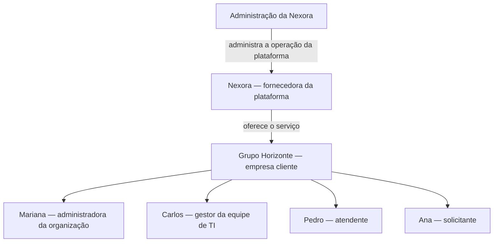
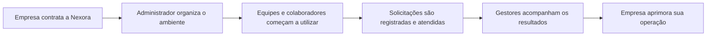
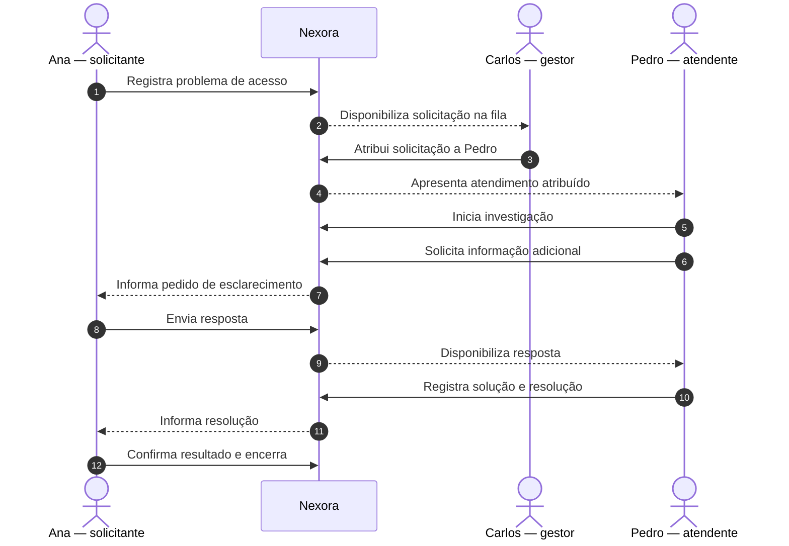
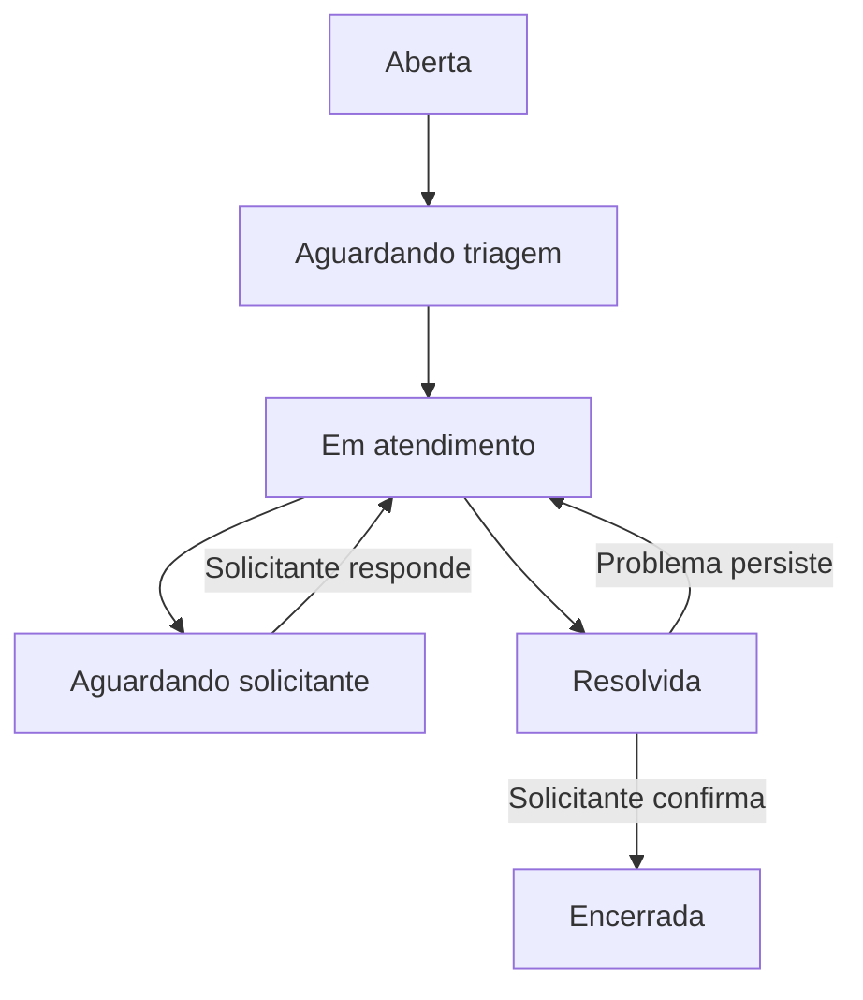
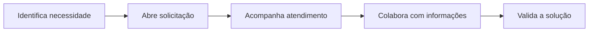
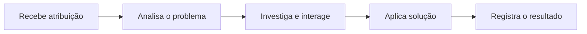
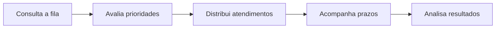
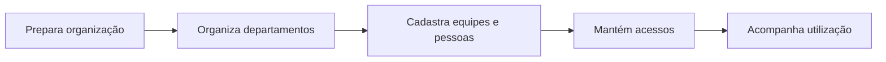
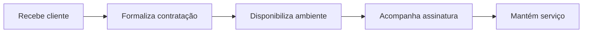

# NEXORA
## Parte 02 — Atores e jornadas do negócio

> **Documento de descoberta do negócio**  
> Continuação de *Parte 01 — História do Projeto*.

## 1. A empresa por trás da plataforma

A Nexora oferece a empresas um ambiente centralizado para organizar solicitações de serviços corporativos. Seus clientes utilizam a plataforma para conectar quem precisa de um serviço às pessoas responsáveis por executá-lo. A Nexora mantém a operação da plataforma; cada empresa cliente conduz seus próprios atendimentos.

O Grupo Horizonte, empresa com cerca de 150 colaboradores, é um desses clientes. Antes da Nexora, as solicitações circulavam entre mensagens, telefonemas e e-mails. Com a plataforma, o Grupo Horizonte passa a ter um lugar comum para registrar, acompanhar e concluir seus atendimentos.

## 2. Quem participa desse negócio

Existem pessoas que administram a relação comercial com a Nexora e pessoas que utilizam a plataforma dentro de cada empresa cliente. No Grupo Horizonte, quatro papéis participam diretamente do atendimento: administrador da organização, gestor de equipe, atendente e solicitante.

### Mariana — administradora da organização

Mariana é responsável por preparar o ambiente do Grupo Horizonte para o uso cotidiano. Ela organiza os departamentos e as equipes, cadastra colaboradores e acompanha quem tem acesso às atividades da empresa. Quando um novo funcionário chega, Mariana garante que ele possa participar dos processos necessários. Quando alguém muda de equipe, ela acompanha a atualização de suas responsabilidades.

### Carlos — gestor de equipe

Carlos coordena a equipe de tecnologia. Ao começar o dia, ele consulta a fila de solicitações, identifica os atendimentos que exigem atenção e distribui o trabalho entre os atendentes. Ao longo do expediente, acompanha os prazos e intervém quando há bloqueios ou demandas urgentes. Seu trabalho não é apenas resolver problemas técnicos, mas manter o atendimento organizado.

### Pedro — atendente

Pedro é um dos profissionais da equipe de TI. Ele recebe solicitações, investiga os problemas, conversa com os solicitantes e registra o que foi feito. Em alguns casos, resolve a demanda rapidamente. Em outros, precisa pedir informações, consultar colegas ou aguardar uma condição externa. O registro do atendimento permite que outras pessoas compreendam o histórico da solicitação.

### Ana — solicitante

Ana trabalha no setor comercial. Quando precisa de um serviço, abre uma solicitação, descreve sua necessidade e acompanha as atualizações. Ela pode fornecer informações adicionais durante o atendimento e, quando a equipe informa que o problema foi resolvido, verifica se o resultado atende à sua necessidade.

### Administração da Nexora

A equipe responsável pela Nexora mantém o serviço utilizado pelas empresas clientes. Ela acompanha a contratação, as assinaturas e a continuidade da operação da plataforma. Essa atividade é distinta da administração dos chamados internos do Grupo Horizonte: a Nexora fornece o ambiente, enquanto a empresa cliente administra seus próprios serviços.

## 3. A jornada de uma empresa cliente

A história do Grupo Horizonte começa quando a diretoria decide substituir os canais dispersos de atendimento por um processo centralizado. A empresa contrata a Nexora, recebe acesso ao ambiente e indica Mariana como responsável pela organização inicial.

Mariana prepara os departamentos, organiza as equipes e habilita os colaboradores. Carlos passa a visualizar as solicitações destinadas à equipe de TI. Pedro utiliza o ambiente para executar os atendimentos. Ana e os demais funcionários começam a registrar pedidos diretamente na plataforma.

Com o passar das semanas, os registros deixam de ser apenas uma lista de problemas: passam a contar a história operacional da empresa, mostrando o que foi solicitado, quem atuou, quais dificuldades surgiram e como cada situação terminou.

## 4. Uma solicitação do início ao fim

Em uma manhã de segunda-feira, Ana tenta acessar o sistema de vendas e recebe uma mensagem informando que não possui permissão. Como depende do sistema para trabalhar, ela entra na Nexora e registra a solicitação **“Sem acesso ao sistema de vendas”**. Ela descreve o erro e anexa uma captura da tela.

A solicitação chega à fila da equipe de TI. Carlos analisa o problema, identifica sua urgência e atribui o atendimento a Pedro. Pedro examina o relato e inicia a investigação. Para confirmar a causa, pede a Ana que informe quando o erro começou. A solicitação permanece aguardando essa resposta.

Ana responde ainda pela manhã. Pedro identifica que a permissão de acesso havia sido alterada, corrige a configuração e registra a solução. Ele informa que a solicitação está resolvida. Ana testa novamente o sistema, confirma que consegue trabalhar e encerra o atendimento.

Agora Carlos consegue verificar não apenas que a solicitação foi concluída, mas também quando foi aberta, quem a atendeu, por que houve uma espera e qual solução foi aplicada.

## 5. O caminho de uma solicitação

Nem todas as solicitações seguem o mesmo ritmo. Algumas são resolvidas sem interrupções; outras dependem de informações adicionais. Há ainda situações em que a solução apresentada precisa ser revista. O fluxo abaixo representa o caminho vivido por Ana e a possibilidade de retomada do atendimento.

Esse desenho retrata a experiência operacional descrita nesta história. As condições formais de cada mudança de estado serão registradas na documentação das regras de negócio.

## 6. As jornadas vistas por cada participante

### A jornada de Ana

Ana identifica uma necessidade, descreve a solicitação e recebe um registro para acompanhamento. Durante o atendimento, acompanha as mensagens e fornece esclarecimentos quando necessário. Ao final, verifica o resultado e confirma se sua necessidade foi atendida.

### A jornada de Pedro

Pedro acompanha os atendimentos sob sua responsabilidade, entende o contexto de cada solicitação, investiga a situação e mantém o solicitante informado. Quando encontra uma solução, registra o que realizou para preservar o conhecimento do atendimento.

### A jornada de Carlos

Carlos observa a demanda recebida pela equipe, identifica prioridades, atribui responsáveis e acompanha a evolução dos atendimentos. Quando um caso fica parado ou se torna urgente, ele atua para reorganizar o trabalho. Ao longo do tempo, utiliza os registros para compreender a capacidade e as dificuldades da equipe.

### A jornada de Mariana

Mariana organiza a estrutura de uso da Nexora no Grupo Horizonte. Ela acompanha a entrada e saída de colaboradores, mantém equipes organizadas e assegura que a plataforma reflita a estrutura operacional da empresa.

### A jornada da administração da Nexora

A administração da Nexora acompanha a entrada de empresas clientes, a manutenção de seus contratos e a continuidade do serviço. Seu relacionamento principal é com as organizações contratantes, não com a execução cotidiana de cada atendimento interno.

## 7. O cotidiano além de um único chamado

Com o crescimento do uso, o Grupo Horizonte começa a registrar solicitações de diferentes departamentos. A equipe de TI atende problemas de acesso e equipamentos; o RH recebe demandas de documentação; o financeiro acompanha solicitações administrativas. Cada departamento mantém sua própria rotina, mas os colaboradores encontram um canal comum para registrar e acompanhar necessidades.

Uma solicitação pode exigir apenas uma pessoa ou envolver várias interações. Em determinados dias, a quantidade de demandas aumenta e os gestores precisam redistribuir o trabalho. Em outros, os atendimentos ficam bloqueados aguardando respostas. Os registros preservam o contexto dessas situações e ajudam a empresa a entender onde seu processo funciona bem e onde surgem dificuldades.

A Nexora não substitui o trabalho humano de decidir, investigar e resolver. Ela torna esse trabalho visível, coordenado e rastreável.

## 8. O valor entregue pelo negócio

Para Ana, a Nexora significa saber onde pedir ajuda e acompanhar sua solicitação. Para Pedro, significa receber um atendimento com contexto e registrar sua solução. Para Carlos, significa coordenar a equipe com uma visão compartilhada das demandas. Para Mariana, significa manter a utilização da plataforma organizada dentro da empresa. Para o Grupo Horizonte, significa transformar solicitações dispersas em uma operação acompanhável.

Para a própria Nexora, o negócio consiste em oferecer essa capacidade a diferentes empresas por meio de um serviço contínuo. Cada organização administra suas pessoas e seus atendimentos, enquanto a Nexora sustenta a plataforma que conecta essas operações.

---

**Fim da Parte 02 — Atores e jornadas do negócio.**
