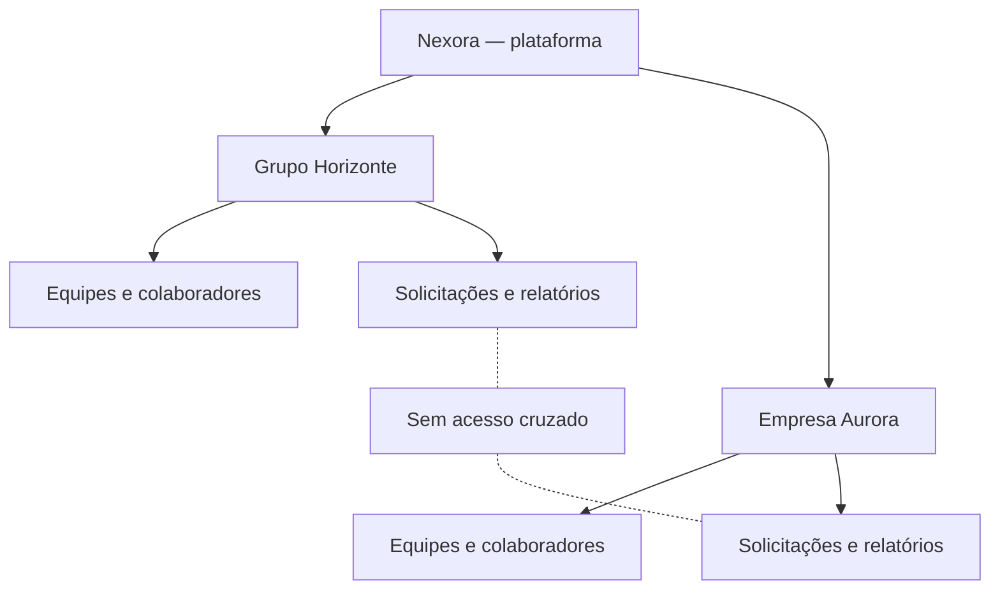
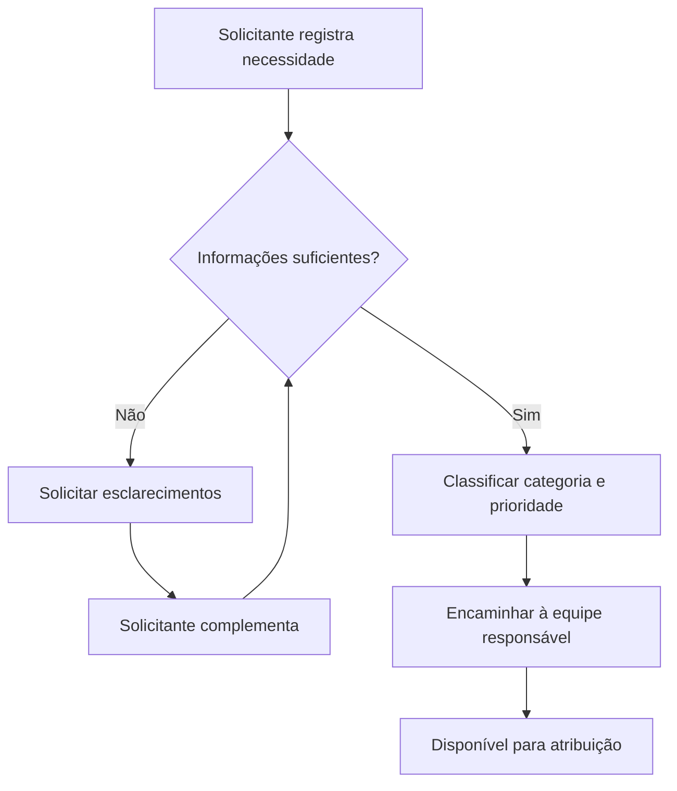
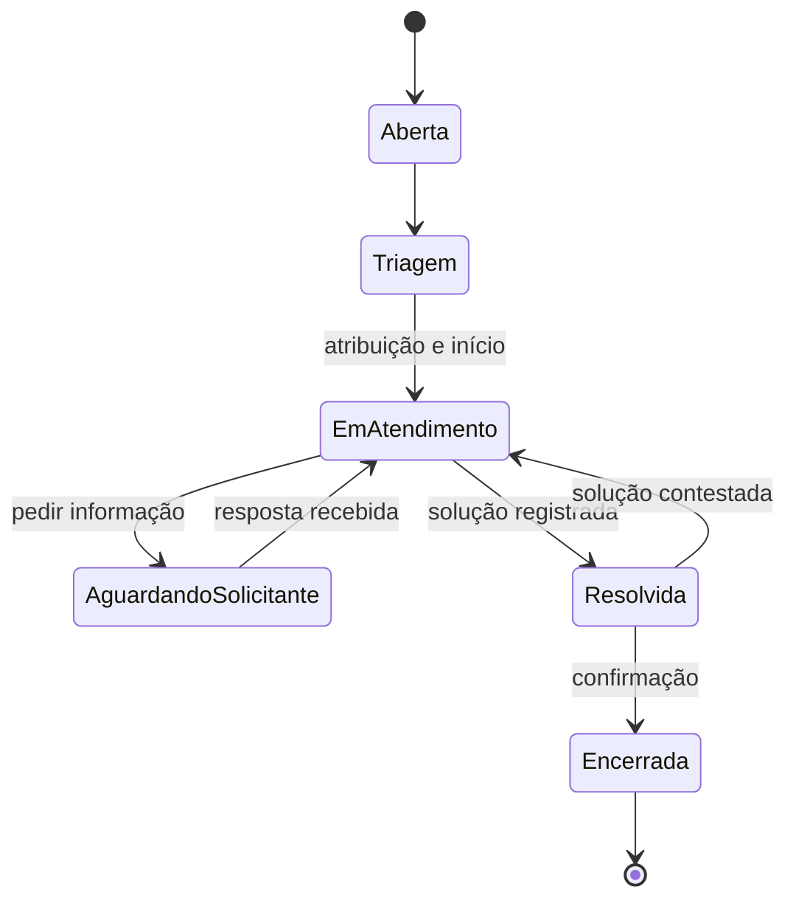

# NEXORA
## Parte 03 — Regras e políticas de negócio

> **Documento de descoberta do negócio**  
> Continuação da *Parte 01 — História do Projeto* e da *Parte 02 — Atores e Jornadas do Negócio*.  
> **Escopo:** funcionamento da plataforma de serviços corporativos, sem decisões de arquitetura ou implementação.

## 1. Por que a Nexora precisa de regras

No Grupo Horizonte, Ana não precisa saber como a Nexora foi construída. Ela precisa ter certeza de que sua solicitação será recebida, de que alguém assumirá a responsabilidade e de que poderá acompanhar o resultado. Carlos precisa distribuir o trabalho de maneira justa. Pedro precisa saber quando pode iniciar, interromper e concluir um atendimento. Mariana precisa proteger as informações da empresa.

As regras de negócio da Nexora transformam essas expectativas em compromissos claros. Elas determinam o que pode acontecer, quem pode tomar decisões e como a empresa lida com exceções.

## 2. Organizações e separação de informações

**RN-ORG-01 — Ambiente de cada empresa.** Cada empresa cliente possui seu próprio espaço de operação, com colaboradores, departamentos, equipes, solicitações e relatórios associados a ela.

**RN-ORG-02 — Isolamento entre clientes.** Um colaborador do Grupo Horizonte não pode consultar, alterar ou receber solicitações de outra empresa cliente da Nexora.

**RN-ORG-03 — Administração da empresa cliente.** A organização designa pessoas responsáveis por manter seus cadastros e definir quem pode atuar em seus processos.

**RN-ORG-04 — Operação da fornecedora.** A administração comercial da Nexora não se confunde com a execução dos atendimentos internos de cada cliente.

## 3. Pessoas, equipes e responsabilidades

**RN-PES-01 — Vínculo com a organização.** Para participar de um atendimento interno, a pessoa deve estar vinculada à organização responsável por ele.

**RN-PES-02 — Responsabilidades por atuação.** Um colaborador pode solicitar serviços; profissionais designados como atendentes podem executá-los; gestores podem organizar o trabalho de suas equipes; administradores podem organizar o ambiente da empresa.

**RN-PES-03 — Equipe responsável.** Cada solicitação encaminhada para atendimento deve ter uma equipe responsável, mesmo que ainda não exista um atendente individual designado.

**RN-PES-04 — Atribuição válida.** Uma solicitação só pode ser atribuída a um atendente habilitado na organização e autorizado a atuar na equipe responsável.

**RN-PES-05 — Mudança de equipe.** Quando uma solicitação precisa ser transferida para outra equipe, o motivo e a mudança de responsabilidade devem ficar registrados.

**RN-PES-06 — Desligamento ou afastamento.** A saída de um atendente não apaga o trabalho já realizado. Solicitações ainda sob sua responsabilidade precisam ser redistribuídas.

### Exemplo: um atendimento atribuído à pessoa errada

Carlos tenta encaminhar uma solicitação de TI para um profissional que trabalha exclusivamente no Financeiro. A Nexora não aceita a atribuição enquanto esse profissional não estiver habilitado a atender pela equipe de TI. Carlos pode escolher outro atendente ou encaminhar a solicitação para a equipe correta.

## 4. Abertura e triagem das solicitações

**RN-SOL-01 — Identificação.** Toda solicitação recebe um protocolo único dentro da organização e preserva a identidade de quem a abriu.

**RN-SOL-02 — Informações mínimas.** Uma solicitação deve conter um título, uma descrição compreensível e uma categoria de serviço.

**RN-SOL-03 — Registro de origem.** A data de abertura e a organização responsável fazem parte do registro da solicitação.

**RN-SOL-04 — Triagem.** Antes do atendimento, a solicitação passa por uma avaliação de enquadramento, prioridade e equipe responsável.

**RN-SOL-05 — Prioridade.** A prioridade expressa o impacto e a urgência do serviço, e pode ser revista por quem possui responsabilidade de triagem. Toda revisão fica registrada.

**RN-SOL-06 — Informação complementar.** Quando o relato não é suficiente, a equipe pode solicitar esclarecimentos sem perder o histórico original.

## 5. Atendimento e ciclo de vida

**RN-ATD-01 — Início do atendimento.** Uma solicitação só entra em atendimento quando há um atendente responsável.

**RN-ATD-02 — Espera identificada.** Se o trabalho depende de uma resposta do solicitante, a solicitação fica identificada como aguardando solicitante, com o motivo da espera.

**RN-ATD-03 — Retomada.** Quando a informação solicitada é fornecida, o atendimento pode ser retomado sem perder os registros anteriores.

**RN-ATD-04 — Resolução documentada.** Para declarar uma solicitação resolvida, o atendente registra o que foi feito e o resultado obtido.

**RN-ATD-05 — Confirmação.** O solicitante pode confirmar que a solução atende à necessidade e encerrar a solicitação.

**RN-ATD-06 — Contestação.** Se a solução não funcionar, o solicitante pode contestá-la e devolver a solicitação ao atendimento, explicando o motivo.

**RN-ATD-07 — Encerramento.** Uma solicitação encerrada deixa de receber alterações operacionais comuns; sua história permanece disponível para consulta autorizada.

**RN-ATD-08 — Rastreabilidade.** Mudanças de status, equipe, atendente, prioridade e resolução preservam autor, momento e contexto da mudança.

O diagrama mostra o fluxo principal de negócio. Casos de cancelamento, ausência prolongada de resposta e encerramento administrativo serão tratados como políticas específicas, sem presumir que equivalem a uma resolução bem-sucedida.

## 6. Comunicação, comentários e evidências

**RN-COM-01 — Conversa vinculada.** As mensagens sobre um atendimento permanecem associadas à solicitação correspondente.

**RN-COM-02 — Identificação do participante.** Cada mensagem indica quem a registrou e quando foi enviada.

**RN-COM-03 — Evidências.** O solicitante e os responsáveis pelo atendimento podem incluir documentos ou imagens pertinentes à solicitação, respeitando as permissões de acesso.

**RN-COM-04 — Histórico preservado.** Comentários e registros anteriores não desaparecem quando o atendimento muda de equipe ou de responsável.

**RN-COM-05 — Comunicação contextual.** Uma notificação informa que houve uma mudança ou pedido de ação; o registro da solicitação continua sendo a referência oficial do atendimento.

## 7. Prazos e compromissos de atendimento

**RN-PRA-01 — Prazo de serviço.** Categorias de serviço podem possuir compromissos de prazo conhecidos pelas equipes e gestores.

**RN-PRA-02 — Prioridade e prazo.** A prioridade influencia a urgência do atendimento, mas não substitui o compromisso de serviço estabelecido para a categoria.

**RN-PRA-03 — Visibilidade de atrasos.** Gestores conseguem identificar solicitações próximas do vencimento ou atrasadas.

**RN-PRA-04 — Esperas justificadas.** Períodos aguardando informações do solicitante devem ser identificáveis para que o cumprimento dos prazos seja avaliado de forma justa.

**RN-PRA-05 — Registro de exceções.** Alterações excepcionais de prazo precisam ter justificativa e responsável identificados.

### Exemplo: a urgência de Ana

O problema de acesso ao sistema de vendas impede Ana de trabalhar. Carlos considera a solicitação urgente e a encaminha rapidamente. Se Pedro precisar aguardar uma informação de Ana, a espera fica registrada; isso permite distinguir tempo de trabalho da equipe e tempo dependente de resposta externa.

## 8. Visibilidade e prestação de contas

**RN-VIS-01 — Acompanhamento pelo solicitante.** Ana consegue consultar suas solicitações, o estado atual, os pedidos de esclarecimento e o resultado registrado.

**RN-VIS-02 — Visão operacional.** Pedro acompanha os atendimentos sob sua responsabilidade.

**RN-VIS-03 — Visão gerencial.** Carlos acompanha a fila e o desempenho das equipes que gerencia.

**RN-VIS-04 — Visão organizacional.** Mariana pode acompanhar a utilização da plataforma e a organização dos processos, conforme suas responsabilidades.

**RN-VIS-05 — Indicadores verificáveis.** Relatórios devem refletir os acontecimentos registrados nas solicitações, incluindo transferências, esperas, resoluções e encerramentos.

## 9. Situações excepcionais

### 9.1 Solicitante não responde

Pedro solicita uma informação necessária e Ana não responde. O atendimento não pode ser tratado automaticamente como resolvido apenas porque houve silêncio. A situação permanece identificada como pendente de resposta até a aplicação de uma política de prazo e encerramento administrativo, quando definida pela organização.

### 9.2 Solução não resolveu o problema

Pedro informa que o acesso foi restabelecido, mas Ana continua recebendo o erro. Ana contesta a resolução. O atendimento retorna ao trabalho, preservando a solução tentada e o motivo da contestação.

### 9.3 Atendente muda de equipe

Pedro passa a trabalhar em outro departamento enquanto possui solicitações em andamento. Carlos identifica os atendimentos pendentes e redistribui as responsabilidades, sem apagar as ações de Pedro.

### 9.4 Solicitação encaminhada à equipe incorreta

Um pedido inicialmente classificado como TI depende, na realidade, de uma autorização do RH. A solicitação é transferida para a equipe adequada, com justificativa e histórico da transferência.

### 9.5 Empresa cliente perde acesso ao serviço

Uma alteração na situação comercial da empresa pode afetar sua capacidade de utilizar a Nexora. Isso não significa que seu histórico operacional deva ser apagado. O tratamento do acesso e da conservação dos registros segue as condições contratuais e as obrigações aplicáveis.

## 10. O que essas regras representam para o negócio

As regras da Nexora procuram equilibrar quatro necessidades: o solicitante precisa de previsibilidade; o atendente precisa de contexto e responsabilidade clara; o gestor precisa de visibilidade e capacidade de intervenção; a empresa cliente precisa de segurança e rastreabilidade.

A Nexora não existe apenas para mover solicitações entre estados. Ela cria um acordo operacional compartilhado sobre quem deve agir, o que foi realizado e como a organização pode aprender com cada atendimento.

---

**Fim da Parte 03 — Regras e políticas de negócio.**
