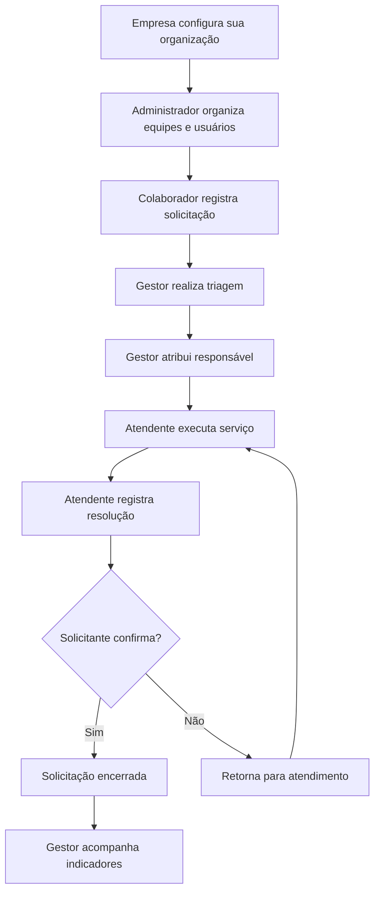
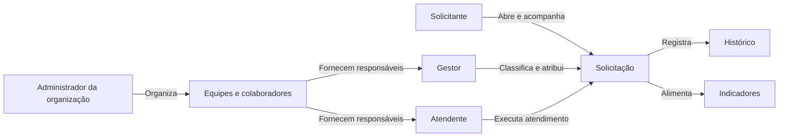

# NEXORA — Parte 04: Escopo do MVP e Linguagem Ubíqua

> Documento de descoberta do negócio | Versão 1.0 | 11 de outubro de 2026

## 1. Objetivo

Delimitar a primeira versão operacional da Nexora e estabelecer um vocabulário compartilhado entre pessoas do negócio e equipe de desenvolvimento. Este documento não define arquitetura, banco de dados nem tecnologias.

## 2. Visão do primeiro produto

A Nexora permite que uma empresa organize solicitações internas de serviços, distribua responsabilidades, acompanhe a execução e compreenda os resultados. O primeiro produto atende múltiplas empresas, com informações isoladas entre elas, e começa com um fluxo de atendimento comum a diferentes departamentos.

### 2.1 Jornada central

## 3. Capacidades incluídas no MVP

| Área             | Capacidades de negócio                                                                                    |
| ---------------- | --------------------------------------------------------------------------------------------------------- |
| Organizações     | Criar organização e configurar dados básicos; manter isolamento entre empresas                            |
| Pessoas e acesso | Cadastrar colaboradores, ativar ou desativar acesso, autenticar e atribuir papéis                         |
| Equipes          | Criar equipes, vincular membros e designar gestores                                                       |
| Solicitações     | Registrar título, descrição, categoria e evidências; consultar solicitações e acompanhar estado           |
| Triagem          | Classificar prioridade, encaminhar à equipe e designar atendente                                          |
| Atendimento      | Registrar interações, solicitar esclarecimentos, informar resolução e permitir confirmação ou contestação |
| Rastreabilidade  | Consultar histórico de eventos importantes, incluindo mudanças de estado e responsável                    |
| Gestão           | Filtrar solicitações e visualizar indicadores básicos de volume, pendências e resolução                   |

## 4. Fora do escopo do MVP

- Cobrança automatizada, gateway de pagamentos e faturamento recorrente.
- Construtor visual de fluxos personalizados por departamento.
- Automações complexas e regras configuráveis de roteamento.
- Aplicativo móvel completo; a operação inicial será pela interface web responsiva.
- Integrações profundas com ERPs, diretórios corporativos e mensageria externa.
- Relatórios avançados, previsão de demanda e recursos de inteligência artificial.

Essas capacidades são possibilidades de evolução, não compromissos da primeira entrega.

## 5. Critérios de conclusão do MVP

O MVP estará operacional quando:

1. Uma organização puder configurar seu ambiente e cadastrar colaboradores e equipes.
2. Um solicitante puder registrar e acompanhar uma solicitação.
3. Um gestor puder realizar triagem e atribuir a solicitação a um atendente elegível.
4. Um atendente puder registrar interações e uma resolução.
5. O solicitante puder confirmar a resolução ou contestá-la, retornando o trabalho ao atendimento.
6. O histórico permitir reconstruir os principais acontecimentos da solicitação.
7. Um gestor puder consultar solicitações pendentes, resolvidas e encerradas.
8. Usuários de uma organização não puderem visualizar ou operar dados de outra.

## 6. Linguagem ubíqua

| Termo                        | Definição no negócio                                                | Não confundir com                |
| ---------------------------- | ------------------------------------------------------------------- | -------------------------------- |
| Nexora                       | Empresa e plataforma que oferece gestão de serviços corporativos    | Empresa cliente                  |
| Organização                  | Empresa cliente que utiliza a plataforma                            | Equipe ou departamento           |
| Colaborador                  | Pessoa vinculada a uma organização                                  | Papel de acesso                  |
| Solicitante                  | Pessoa que registra uma necessidade                                 | Atendente                        |
| Administrador da organização | Responsável pela configuração e governança do ambiente da empresa   | Administrador da Nexora          |
| Gestor de equipe             | Responsável pela coordenação dos serviços de uma equipe             | Administrador da organização     |
| Atendente                    | Pessoa que executa ou acompanha o serviço atribuído                 | Solicitante                      |
| Equipe                       | Conjunto de colaboradores responsável por serviços                  | Organização                      |
| Categoria de serviço         | Classificação da natureza de uma necessidade                        | Prioridade                       |
| Solicitação                  | Registro formal de uma necessidade de serviço                       | Atendimento                      |
| Triagem                      | Avaliação inicial para classificar e encaminhar uma solicitação     | Resolução                        |
| Prioridade                   | Grau de urgência ou impacto considerado na condução da solicitação  | Estado                           |
| Atribuição                   | Designação de quem ficará responsável pelo trabalho                 | Transferência entre organizações |
| Atendimento                  | Conjunto de ações para atender à solicitação                        | Abertura da solicitação          |
| Interação                    | Comunicação registrada durante o atendimento                        | Mudança de estado                |
| Resolução                    | Declaração de que o serviço foi executado ou o problema solucionado | Encerramento definitivo          |
| Contestação                  | Manifestação do solicitante de que a solução não foi suficiente     | Nova solicitação                 |
| Encerramento                 | Finalização do ciclo de uma solicitação                             | Resolução                        |
| Histórico                    | Registro cronológico dos acontecimentos relevantes                  | Comentário livre                 |
| SLA                          | Compromisso de nível de serviço, incluindo condições de prazo       | Prioridade                       |

### 6.1 Distinções fundamentais

**Solicitação e atendimento:** a solicitação expressa a necessidade; o atendimento representa o trabalho para satisfazê-la. Uma solicitação pode exigir várias interações antes da resolução.

**Resolução e encerramento:** resolver significa informar que a necessidade foi atendida; encerrar significa finalizar o ciclo após a confirmação prevista pelo negócio.

**Papel e pessoa:** uma pessoa pode assumir responsabilidades distintas conforme sua atuação. O papel não define uma pessoa diferente.

**Prioridade e estado:** prioridade informa a relevância do atendimento; estado informa a etapa do processo.

## 7. Visão das interações de negócio

## 8. Exemplo narrativo: o acesso de Ana

Ana, colaboradora do Grupo Horizonte, não consegue acessar o sistema de vendas. Ela registra uma solicitação na Nexora, descreve a dificuldade e anexa uma captura de tela. O pedido passa por triagem, recebe prioridade e é encaminhado à equipe de TI. Carlos atribui o trabalho a Pedro, que investiga o problema e pede uma informação complementar. Ana responde pela própria solicitação. Pedro restaura a permissão necessária e registra a resolução. Ana confirma que voltou a acessar o sistema; a solicitação é encerrada. Ao consultar os resultados do mês, Carlos consegue identificar o atendimento e seus principais acontecimentos.

## 9. Fronteiras do documento

Este texto estabelece o escopo funcional e os significados de negócio para o MVP. A definição detalhada de políticas, exceções, fronteiras de contexto, agregados, contratos e persistência pertence a etapas posteriores. Os termos apresentados constituem um vocabulário inicial a ser validado e refinado durante a descoberta do domínio.
