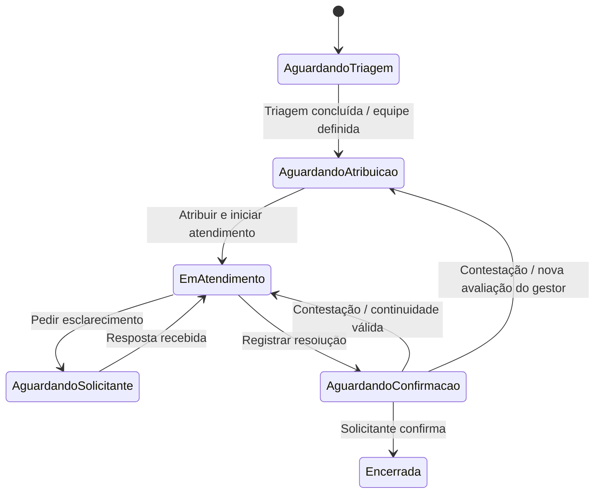

# NEXORA — Parte 06: Requisitos Consolidados e Modelagem Tática Inicial — Solicitações

> **Versão 1.0 — baseline do MVP para a NEX-009** | 17 de outubro de 2026  
> **Referências:** Parte 03 — Regras e políticas de negócio; Parte 04 — Escopo do MVP e Linguagem Ubíqua; Parte 06 v0.1; decisões de descoberta da Sprint 02.  
> **Natureza:** referência funcional para a modelagem e implementação. Não é contrato de API, esquema SQL nem decisão definitiva de arquitetura.

## 1. Objetivo e limites

Consolidar os requisitos funcionais, regras de negócio, invariantes e fluxos essenciais de **Gestão de Solicitações**. Este documento é suficiente como **baseline do MVP**, mas não pretende antecipar todas as políticas e exceções possíveis.

O domínio de Solicitações registra e acompanha a necessidade; **Atendimento** registra o trabalho realizado para satisfazê-la. Organizações, Equipes e Identidade/Acesso fornecem informações necessárias para validar ações, mas seus modelos completos não pertencem automaticamente ao agregado Solicitação.

**Classificação das decisões:**

- **Confirmada:** consta dos documentos anteriores ou foi decidida explicitamente na descoberta.
- **Padrão provisório do MVP:** decisão operacional simples adotada para permitir implementação; pode ser revisada.
- **Pendente/não bloqueante:** não impede iniciar a modelagem tática.
- **Pós-MVP:** melhoria adiada deliberadamente.

## 2. Atores e responsabilidades

| Ator/papel                   | Responsabilidade no processo                                                                            |
| ---------------------------- | ------------------------------------------------------------------------------------------------------- |
| Solicitante                  | Abre a solicitação, acompanha o atendimento, fornece esclarecimentos, confirma ou contesta a resolução. |
| Gestor                       | Faz triagem, define/revisa prioridade, encaminha à equipe e atribui/reatribui atendentes.               |
| Atendente                    | Executa o serviço, registra interações e documenta a resolução.                                         |
| Administrador da organização | Gerencia pessoas, papéis e equipes no ambiente da organização.                                          |

**Decisão confirmada:** os papéis não são mutuamente exclusivos. Um gestor pode abrir uma solicitação e realizar sua própria triagem no MVP. Uma política que restrinja esse comportamento por organização fica para o pós-MVP.

## 3. Requisitos funcionais do MVP

| ID    | Requisito                                                                                             | Situação                                                                                        |
| ----- | ----------------------------------------------------------------------------------------------------- | ----------------------------------------------------------------------------------------------- |
| RF-01 | Registrar solicitação vinculada a uma organização e a um solicitante.                                 | Confirmada                                                                                      |
| RF-02 | Informar título, descrição e categoria na abertura; aceitar evidências/anexos quando disponíveis.     | Confirmada quanto aos campos mínimos pela Parte 03; evidências opcionais como padrão provisório |
| RF-03 | Consultar solicitações e acompanhar seu estado.                                                       | Confirmada                                                                                      |
| RF-04 | Realizar triagem, classificar prioridade e encaminhar à equipe responsável.                           | Confirmada                                                                                      |
| RF-05 | Atribuir e reatribuir um atendente elegível.                                                          | Confirmada                                                                                      |
| RF-06 | Registrar interações e esclarecimentos no atendimento.                                                | Confirmada                                                                                      |
| RF-07 | Registrar resolução documentada sem encerrar automaticamente a solicitação.                           | Confirmada                                                                                      |
| RF-08 | Permitir que o solicitante confirme ou conteste a resolução.                                          | Confirmada                                                                                      |
| RF-09 | Preservar e consultar histórico de alterações e atividades, conforme autorização.                     | Confirmada                                                                                      |
| RF-10 | Permitir desativação de usuário sem apagar atribuições existentes; permitir reatribuição posterior.   | Confirmada na Sprint 02                                                                         |
| RF-11 | Na contestação, permitir solicitar continuidade com o atendente anterior ou nova avaliação do gestor. | Confirmada na Sprint 02                                                                         |
| RF-12 | Permitir consulta gerencial das solicitações pendentes, resolvidas e encerradas.                      | Confirmada                                                                                      |

## 4. Dados conceituais

| Dado                    | Regra/observação                                                                                       | Situação                                                     |
| ----------------------- | ------------------------------------------------------------------------------------------------------ | ------------------------------------------------------------ |
| Identificador/protocolo | Protocolo único dentro da organização.                                                                 | Confirmada (Parte 03)                                        |
| Organização             | Obrigatória; delimita isolamento entre clientes.                                                       | Confirmada                                                   |
| Solicitante             | Obrigatório e identificável.                                                                           | Confirmada                                                   |
| Título e descrição      | Obrigatórios e não vazios; clareza textual é uma avaliação de negócio, não apenas validação de string. | Confirmada quanto à presença; critérios detalhados pendentes |
| Categoria de serviço    | Obrigatória na abertura conforme RN-SOL-02 da Parte 03.                                                | Confirmada por documento anterior                            |
| Evidências              | Podem acompanhar a abertura; ausência não bloqueia por padrão.                                         | Padrão provisório do MVP                                     |
| Prioridade              | Classificada/revisada na triagem, com registro da mudança.                                             | Confirmada                                                   |
| Equipe responsável      | Necessária ao concluir o encaminhamento da triagem.                                                    | Confirmada                                                   |
| Atendente atual         | No máximo um responsável individual atual.                                                             | Padrão provisório do MVP                                     |
| Estado                  | Expressa a etapa do ciclo da solicitação.                                                              | Confirmada; nomenclatura operacional provisória              |
| Data de abertura        | Deve ser preservada.                                                                                   | Confirmada (Parte 03)                                        |
| Histórico               | Preserva autor, momento e contexto de eventos relevantes.                                              | Confirmada                                                   |

## 5. Regras de negócio consolidadas

### 5.1 Organizações, pessoas e atribuição

| ID    | Regra                                                                                                        | Situação   |
| ----- | ------------------------------------------------------------------------------------------------------------ | ---------- |
| RN-01 | Cada solicitação pertence a uma organização; não pode ser operada por usuário de outra organização.          | Confirmada |
| RN-02 | Uma pessoa pode exercer diferentes papéis; o gestor pode solicitar e triar sua própria demanda.              | Confirmada |
| RN-03 | A atribuição exige atendente habilitado, vinculado à organização e autorizado a atuar na equipe responsável. | Confirmada |
| RN-04 | A equipe responsável deve estar definida para encaminhar uma solicitação ao atendimento.                     | Confirmada |
| RN-05 | O gestor pode reatribuir o atendimento quando o responsável não puder continuar.                             | Confirmada |
| RN-06 | Desativar um usuário não exige reatribuição prévia e não apaga as atribuições existentes.                    | Confirmada |
| RN-07 | Um usuário desativado não pode receber **nova atribuição** nem executar novas ações como atendente.          | Confirmada |
| RN-08 | A reatribuição preserva a autoria, os registros e a sequência histórica do atendimento anterior.             | Confirmada |

### 5.2 Abertura, triagem e ciclo

| ID    | Regra                                                                                                                              | Situação                                                     |
| ----- | ---------------------------------------------------------------------------------------------------------------------------------- | ------------------------------------------------------------ |
| RN-09 | A abertura exige organização, solicitante, título, descrição e categoria.                                                          | Confirmada pela Parte 03                                     |
| RN-10 | A solicitação pode existir antes da triagem sem equipe ou atendente individual.                                                    | Confirmada pela jornada; detalhe de implementação provisório |
| RN-11 | A triagem pode ser preenchida progressivamente; seu encaminhamento exige equipe responsável.                                       | Decisão de trabalho mantida                                  |
| RN-12 | A prioridade é definida/revisada na triagem, e cada revisão é rastreável.                                                          | Confirmada                                                   |
| RN-13 | A solicitação somente entra em atendimento com atendente responsável.                                                              | Confirmada pela Parte 03                                     |
| RN-14 | Quando o atendimento depende de esclarecimento do solicitante, essa espera e seu motivo devem ser identificáveis.                  | Confirmada pela Parte 03                                     |
| RN-15 | O atendente deve registrar o trabalho e o resultado para declarar uma resolução.                                                   | Confirmada                                                   |
| RN-16 | Registrar resolução não encerra a solicitação; o encerramento depende de confirmação do solicitante.                               | Confirmada                                                   |
| RN-17 | O solicitante pode contestar a resolução, justificando o motivo, sem apagar o atendimento anterior.                                | Confirmada                                                   |
| RN-18 | Ao contestar, o solicitante pode solicitar continuidade com o atendente anterior ou encaminhamento ao gestor para nova avaliação.  | Confirmada na Sprint 02                                      |
| RN-19 | Se o atendente anterior estiver inativo, a contestação deve seguir para o gestor; não há nova atribuição automática a ele.         | Confirmada na Sprint 02                                      |
| RN-20 | Uma solicitação encerrada não recebe alterações operacionais comuns; seu histórico permanece consultável por usuários autorizados. | Confirmada pela Parte 03                                     |

### 5.3 Histórico e rastreabilidade

| ID    | Regra                                                                                                       | Situação                |
| ----- | ----------------------------------------------------------------------------------------------------------- | ----------------------- |
| RN-21 | Mudanças relevantes de estado, prioridade, equipe, atendente e resolução devem ser rastreáveis.             | Confirmada              |
| RN-22 | O atendente atual pode consultar o histórico do trabalho anterior necessário à continuidade do atendimento. | Confirmada na Sprint 02 |
| RN-23 | O histórico preserva autor, momento e contexto das atividades mesmo após reatribuição ou desativação.       | Confirmada              |

## 6. Invariantes e condições de consistência

Uma **invariante** é uma condição que deve permanecer verdadeira nas operações relevantes. Nem toda regra operacional é uma invariante do agregado; algumas dependem de outros contextos.

| ID     | Condição                                                                               | Responsabilidade provável                   |
| ------ | -------------------------------------------------------------------------------------- | ------------------------------------------- |
| INV-01 | Uma solicitação válida tem organização e solicitante identificáveis.                   | Solicitações                                |
| INV-02 | Uma solicitação aberta tem título, descrição e categoria informados.                   | Solicitações                                |
| INV-03 | Há no máximo um atendente individual designado como responsável **atual**.             | Solicitações (decisão provisória)           |
| INV-04 | Uma solicitação não é definitivamente encerrada sem confirmação válida do solicitante. | Solicitações + autorização                  |
| INV-05 | Reatribuição não altera a autoria nem apaga registros anteriores.                      | Solicitações/Atendimento + histórico        |
| INV-06 | Uma nova atribuição não pode apontar para usuário desativado ou inelegível.            | Política de atribuição + Equipes/Identidade |
| INV-07 | Uma resolução registrada não é tratada automaticamente como encerramento.              | Solicitações                                |
| INV-08 | Atribuição e operações não podem cruzar organizações.                                  | Aplicação + contexto organizacional         |
| INV-09 | Uma contestação não elimina a resolução anterior nem o motivo da contestação.          | Solicitações/Atendimento + histórico        |

**Não são invariantes:** exigir reatribuição antes de desativar um usuário; exigir que toda solicitação com estado de atendimento tenha sempre um atendente **ativo**. Ambas as restrições contradiriam decisões explícitas do MVP. Uma atribuição anterior pode permanecer associada a usuário inativo até que o gestor intervenha.

**Limite técnico:** verificações de elegibilidade, identidade e vínculo organizacional podem exigir consultas ou políticas fora do agregado. A NEX-010/NEX-013 definirá a colaboração sem acoplar o domínio a NestJS ou MySQL.

## 7. Ciclo de vida — fluxo principal do MVP

**Observações:**

- Os nomes dos estados são **provisórios** e serão estabilizados na NEX-010.
- `AguardandoAtribuicao` permite equipe definida sem responsável individual.
- A decisão de retornar ao gestor após contestação está representada como retorno à fila de atribuição, **sem afirmar que a triagem original precisa ser refeita**.
- Desativação de usuário **não muda automaticamente** o estado; o gestor pode reatribuir depois.
- A separação entre “atribuir” e “iniciar trabalho” permanece um detalhe de fluxo a decidir durante a implementação.
- Cancelamento e encerramento administrativo não são implementados neste fluxo inicial até que suas políticas sejam definidas.

## 8. Fluxos principais e alternativos

### F01 — Abertura e atendimento

1. Solicitante registra necessidade com dados mínimos.
2. Gestor realiza triagem, define prioridade e equipe.
3. Gestor atribui atendente elegível.
4. Atendente registra atividades e resolução.
5. Solicitante confirma; a solicitação é encerrada.

### F02 — Contestação e continuidade

1. Atendente registra resolução.
2. Solicitante contesta e informa o motivo.
3. Solicitante solicita continuidade com o atendente anterior **ou** nova avaliação do gestor.
4. Se o atendente anterior estiver inativo/inelegível, o encaminhamento vai ao gestor.
5. A solicitação continua com histórico integral preservado.

### F03 — Desativação e reatribuição

1. Usuário é desativado, mesmo com solicitações atribuídas.
2. Atribuições anteriores e histórico permanecem registrados.
3. Gestor identifica as pendências e reatribui a outro atendente elegível.
4. A nova atribuição não substitui nem altera registros anteriores.

### F04 — Solicitação de esclarecimento

1. Atendente solicita informação adicional.
2. A solicitação identifica que aguarda resposta do solicitante.
3. Solicitante responde e o atendimento é retomado sem perda do histórico.

## 9. Agregado candidato e comportamentos — insumo para NEX-010

**Raiz candidata:** `Solicitação`.

**Responsabilidade candidata:** manter a coerência do ciclo de vida da necessidade, de sua abertura ao encerramento, incluindo a relação com triagem, atribuição e contestação.

**Não incorporar automaticamente:** objetos completos de Organização, Equipe, Colaborador, Atendimento, Interação e Resolução.

| Comportamento candidato              | Intenção                                      |
| ------------------------------------ | --------------------------------------------- |
| `abrir(...)`                         | Registrar necessidade válida.                 |
| `classificarPrioridade(...)`         | Atualizar prioridade com rastreabilidade.     |
| `encaminharParaEquipe(...)`          | Definir equipe responsável.                   |
| `concluirTriagem(...)`               | Encerrar a avaliação inicial quando válida.   |
| `atribuirAtendente(...)`             | Registrar responsável elegível.               |
| `reatribuirAtendente(...)`           | Substituir responsável preservando histórico. |
| `reconhecerResolucaoRegistrada(...)` | Passar a aguardar confirmação.                |
| `confirmarResolucao(...)`            | Encerrar mediante confirmação autorizada.     |
| `contestarResolucao(...)`            | Retomar fluxo após contestação.               |

**Nota:** nomes ilustrativos, não assinaturas finais. Os limites do agregado e a forma de integração com Atendimento são decisões da NEX-010.

## 10. Linguagem ubíqua essencial

| Termo        | Significado                                                 |
| ------------ | ----------------------------------------------------------- |
| Solicitação  | Registro da necessidade de um serviço.                      |
| Atendimento  | Trabalho realizado para atender a solicitação.              |
| Solicitante  | Pessoa que registra e valida a necessidade.                 |
| Gestor       | Pessoa que coordena triagem e atribuições.                  |
| Atendente    | Pessoa responsável pela execução do serviço.                |
| Triagem      | Avaliação e encaminhamento da necessidade.                  |
| Atribuição   | Designação de responsável pelo trabalho.                    |
| Resolução    | Registro de que o atendente considera o trabalho concluído. |
| Contestação  | Rejeição fundamentada da solução pelo solicitante.          |
| Encerramento | Finalização da solicitação após confirmação.                |
| Histórico    | Registro rastreável dos acontecimentos relevantes.          |

## 11. Pendências controladas e pós-MVP

### Decisões que podem ser tomadas ao implementar, sem bloquear a NEX-010

- Se a prioridade precisa estar preenchida antes de concluir a triagem, além da equipe.
- Se atribuição e início efetivo do atendimento serão operações separadas.
- Como representar a pendência de reatribuição após desativação sem criar um estado novo.
- Como tratar confirmações duplicadas/tardias e concorrência entre reatribuição e resolução.
- Como aplicar verificação de elegibilidade com dados de outros contextos.
- Qual mecanismo de persistência/consistência protege histórico e mudanças de estado.

### Fora da primeira implementação do domínio / pós-MVP

- Políticas configuráveis por organização para impedir triagem da própria solicitação.
- Regras sofisticadas de roteamento e redistribuição automática.
- Política completa de cancelamento, expiração e encerramento administrativo.
- Integrações externas de RH para desligamento automático.
- Definição antecipada de Event Sourcing, filas, Outbox ou transações distribuídas.

**Critério para avançar:** a NEX-010 pode começar com o fluxo principal e as invariantes acima. Questões não bloqueantes são registradas e resolvidas quando aparecerem no código ou nos testes, sem nova rodada extensa de descoberta.

## 12. Rastreabilidade e histórico de alterações

| Versão           | Alteração                                                                                                                                                                                         |
| ---------------- | ------------------------------------------------------------------------------------------------------------------------------------------------------------------------------------------------- |
| 0.1 — 11/10/2026 | Hipóteses iniciais de agregado, dados, invariantes, estados e comportamentos.                                                                                                                     |
| 1.0 — 17/10/2026 | Consolidação dos requisitos com a Parte 03/04; inclusão das decisões sobre papéis, desativação, reatribuição, contestação e histórico; separação de requisitos, regras, invariantes e pendências. |

**Próxima atividade:** **NEX-010 — Modelar entidades, Value Objects e agregado de Solicitação**.
